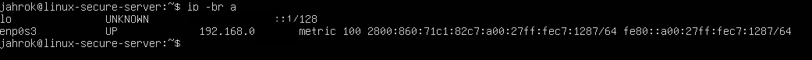
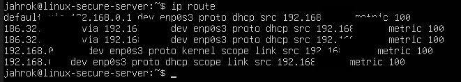
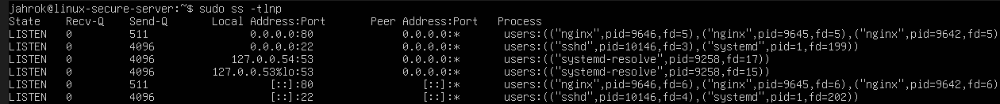
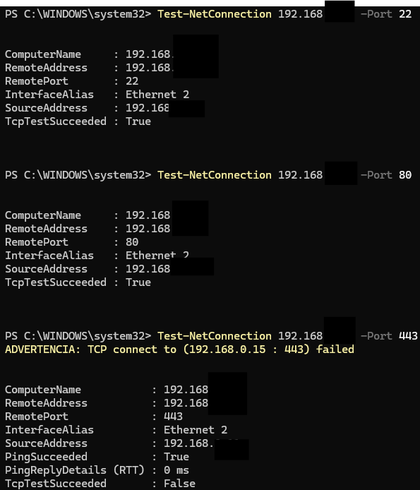

# Lab 01: IP Addressing, Gateway and Ports

> **Privacy note:** all IP addresses (private, public, IPv6 and loopback) have been redacted and replaced by placeholders such as `<VM-IP>` or `<GATEWAY-IP>`. Redacting them does not change how the lab works. Only `0.0.0.0` and `[::]` are shown, because they are generic wildcards meaning "all interfaces".

## Objective
Understand and verify how a Linux server is identified and reached on a network: IP address, subnet mask, default gateway and listening ports.

## Environment
- Ubuntu Server 24.04 LTS virtual machine (VirtualBox, bridged adapter), interface `enp0s3`
- Client: Windows host with PowerShell (`<CLIENT-IP>`)
- Note: the VM address (`<VM-IP>`) is assigned by DHCP and changed after a reboot.

## 1. IP address and subnet mask
Command: `ip -br a`

Result: `enp0s3` has `<VM-IP>/24`, inside the private network `<LAN-SUBNET>`.

- `/24` means the first 24 bits identify the network (mask 255.255.255.0), leaving 254 usable host addresses.
- The client (`<CLIENT-IP>`) is in the same subnet, so both machines communicate directly without a router.
- The interface also has a global IPv6 address (`<GLOBAL-IPV6>`) and a link-local one (`<LINK-LOCAL-IPV6>`). `lo` is the loopback interface (`<LOOPBACK-IP>`).

## 2. Default gateway and routing table
Command: `ip route`

Result:
- `default via <GATEWAY-IP>`: traffic to any destination outside the local subnet goes to the gateway (the router).
- `<LAN-SUBNET> dev enp0s3`: local traffic goes out directly.
- Two host routes (`<ISP-IP-1>` and `<ISP-IP-2>`) also go through the gateway. They were installed by DHCP and are probably the ISP DNS servers (to be confirmed in the DNS lab).

Earlier I diagnosed a DNS failure where a ping to a public IP worked but names did not resolve. That confirms routing and name resolution are separate layers.

## 3. Listening ports
Command: `sudo ss -tlnp` (`-t` TCP, `-l` listening, `-n` numeric, `-p` process)

Result:
- Port 80: nginx, on all IPv4 and IPv6 addresses (`0.0.0.0` and `[::]`).
- Port 22: sshd, on all IPv4 and IPv6 addresses (`0.0.0.0` and `[::]`).
- Port 53 on `<LOCAL-DNS-IP-1>` and `<LOCAL-DNS-IP-2>`: the local DNS resolver (`systemd-resolved`), bound to loopback only, so it is not reachable from the network.

Only the services that must be reachable are exposed.

## 4. Reachability test from the client
Commands (Windows PowerShell):
- `Test-NetConnection <VM-IP> -Port 22` -> TcpTestSucceeded: True
- `Test-NetConnection <VM-IP> -Port 80` -> TcpTestSucceeded: True
- `Test-NetConnection <VM-IP> -Port 443` -> TcpTestSucceeded: False (ping succeeded)

Ports 22 and 80 have a listening service and are allowed in UFW. Port 443 has no service listening and is not allowed by the firewall. The host answers ICMP echo, so the failure is specific to TCP 443 and not a connectivity problem.

## Key takeaways
- A port is reachable only if a service listens on it AND the firewall allows it.
- The subnet mask decides which destinations are local and which go through the gateway.
- Checking from inside the server (`ss`) and from outside (`Test-NetConnection`) avoids false assumptions.
- DHCP addresses can change, so documentation should record how to find the current address.
- IP addresses should be redacted before publishing technical documentation.

## Next
Lab 02: DNS resolution (how a name becomes an IP).