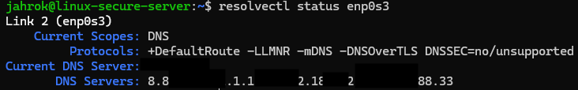
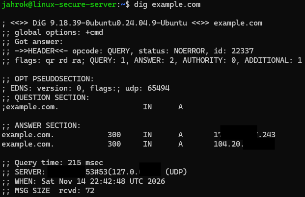
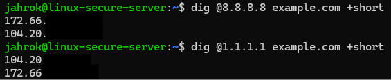
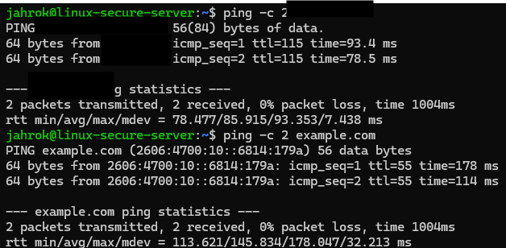

# Lab 02: DNS Resolution

> **Privacy note:** all IP addresses have been redacted and replaced by placeholders such as `<GOOGLE-DNS>` or `<ISP-DNS-1>`. Redacting them does not change how the lab works.

## Objective
Understand how a name becomes an IP address, which DNS servers a Linux host uses, and why name resolution is independent from IP connectivity.

## Environment
- Ubuntu Server 24.04 LTS virtual machine, interface `enp0s3`
- Local resolver: `systemd-resolved` (stub listener on loopback)

## 1. Which DNS servers does the host use?
Command: `resolvectl status enp0s3`

Result: four DNS servers are configured and one is active:
- `<GOOGLE-DNS>` and `<CLOUDFLARE-DNS>`, set manually through a netplan file.
- `<ISP-DNS-1>` and `<ISP-DNS-2>`, assigned by the ISP through DHCP.
- Current DNS server: `<GOOGLE-DNS>`.

This confirms the two extra host routes seen in Lab 01 were the ISP DNS servers.

## 2. Resolving a name
Command: `dig example.com`

Result:
- Status `NOERROR`: the query succeeded.
- Two `A` records (IPv4 addresses), with a TTL of 300 seconds (the answer can be cached for 5 minutes).
- The answer came from `<LOOPBACK-STUB>`, the local resolver, which forwards the query to the active DNS server.
- Query time: 215 ms for the first, uncached lookup.

## 3. Comparing public resolvers
Commands:
- `dig @<GOOGLE-DNS> example.com +short`
- `dig @<CLOUDFLARE-DNS> example.com +short`

Both resolvers returned the same two addresses, only in a different order. Record order rotates, so it must not be relied on.

## 4. IP connectivity vs name resolution
Commands:
- `ping -c 2 <PUBLIC-IP>` -> 0% packet loss
- `ping -c 2 example.com` -> 0% packet loss

Both work now. In my earlier DNS incident the first worked and the second failed, which isolated the fault to name resolution and not to routing or internet access. `ping` resolved the name to an IPv6 address because it prefers IPv6 when the name has an AAAA record, while `dig` showed IPv4 because it asks for `A` records by default.

## Key takeaways
- DNS and IP connectivity are separate layers: test with an IP first, then with a name.
- Linux resolves names through a local stub resolver that forwards to the configured DNS servers.
- Manually configured DNS servers and DHCP-provided ones can coexist; `resolvectl status` shows which is active.
- TTL controls how long an answer is cached.
- `dig @server name` queries a specific resolver, useful to compare or isolate a faulty one.

## Next
Lab 03: HTTP and HTTPS.
