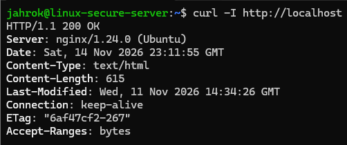
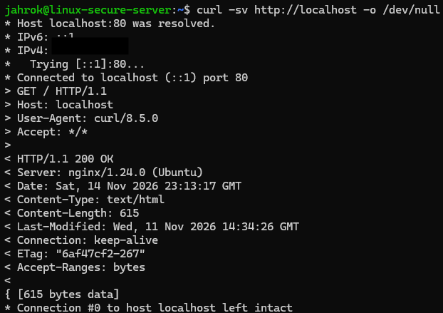
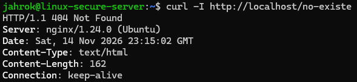
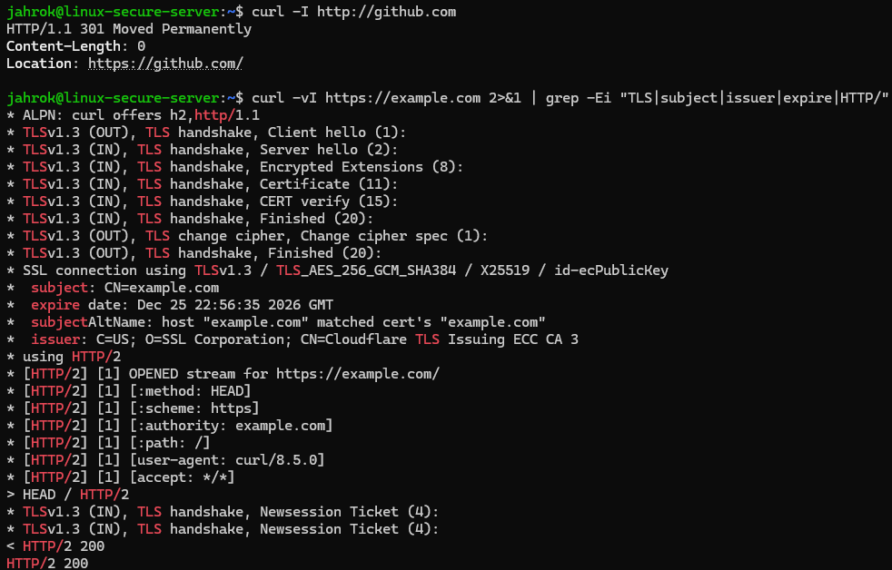

# Lab 03: HTTP and HTTPS

> **Privacy note:** all IP addresses (including loopback) have been redacted and replaced by placeholders such as `<LOOPBACK-IP>` and `<LOOPBACK-IPV6>`. Redacting them does not change how the lab works.

## Objective
Understand how an HTTP request and response work, what status codes mean, how HTTP differs from HTTPS, and how TLS protects a connection.

## Environment
- Ubuntu Server 24.04 LTS virtual machine running nginx 1.24.0
- Tool: `curl` 8.5.0

## 1. Response headers
Command: `curl -I http://localhost`

Result: `HTTP/1.1 200 OK`, with these headers:
- `Server`: identifies the web server and version (information an attacker can use, so it is often hidden in hardened setups).
- `Content-Type` and `Content-Length`: type and size (615 bytes) of the page.
- `Last-Modified` and `ETag`: used by browsers for caching.
- `Connection: keep-alive`: the connection stays open for further requests.

## 2. Request and response in detail
Command: `curl -sv http://localhost -o /dev/null`

- `localhost` resolved to `<LOOPBACK-IPV6>` and `<LOOPBACK-IP>`; curl tried IPv6 first and connected to port 80.
- Lines starting with `>` are the request: `GET / HTTP/1.1` plus the `Host`, `User-Agent` and `Accept` headers.
- Lines starting with `<` are the response: status line and headers, followed by the body (615 bytes).

## 3. Status codes
Commands:
- `curl -I http://localhost/no-existe` -> `404 Not Found`
- `curl -I http://github.com` -> `301 Moved Permanently` with `Location: https://github.com/`

A 404 is a valid answer from a working server: the resource does not exist, but the server and network are fine. A 301 tells the client to use a different address; here it redirects HTTP to HTTPS.

## 4. HTTPS and TLS
Command: `curl -vI https://example.com`

- The TLS 1.3 handshake (client hello, server hello, certificate, finished) negotiates encryption before any HTTP data is sent. Cipher: `TLS_AES_256_GCM_SHA384`.
- The certificate subject is `CN=example.com` and matched the requested hostname, which proves the server is who it claims to be.
- The certificate was signed by a public certificate authority (Cloudflare TLS Issuing ECC CA 3) and expires on Dec 25, 2026. Short-lived certificates are renewed automatically.
- HTTP/2 was negotiated during the handshake (ALPN) and the response was `HTTP/2 200`.

## 5. HTTPS against my own server
Command: `curl -I https://localhost` -> `Failed to connect to localhost port 443`.

nginx on this server only serves HTTP on port 80. No service listens on 443, which explains the closed port observed in Lab 01.

## Key takeaways
- HTTP is a request/response protocol: method and headers go out, status code, headers and body come back.
- Status codes tell what happened: 2xx success, 3xx redirect, 4xx client error, 5xx server error.
- HTTPS is HTTP inside a TLS tunnel: it provides encryption, server identity (certificate) and integrity.
- A certificate must match the hostname, be signed by a trusted authority and not be expired.
- Serving HTTPS on my own server requires a certificate and a service listening on 443.

## Next
Lab 04: Firewalls and subnets.