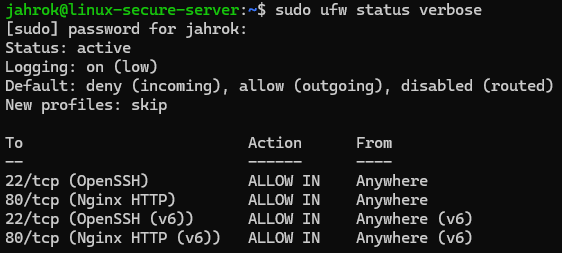
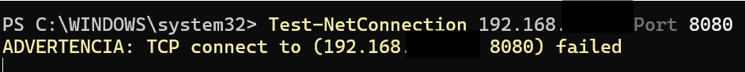
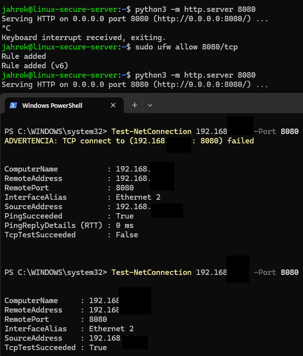
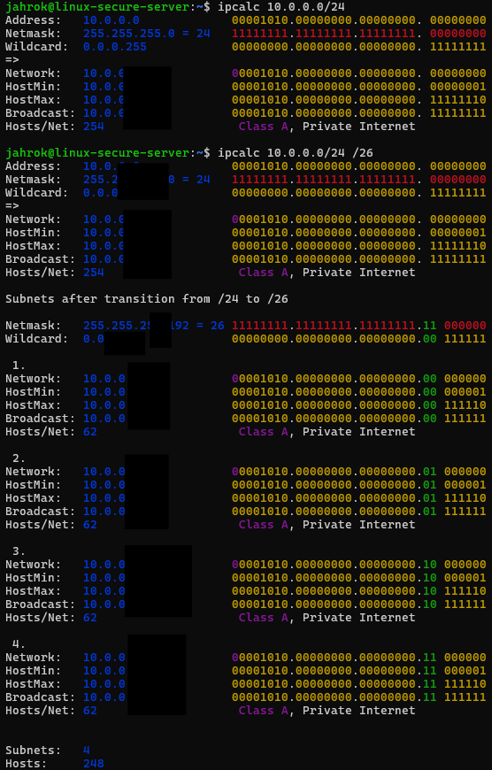

# Lab 04: Firewalls and Subnets

> **Privacy note:** all real IP addresses have been redacted and replaced by placeholders such as `<VM-IP>`. The `10.0.0.0/24` range used in the subnet exercise is a generic example, not my network.

## Objective
Prove that the host firewall (UFW) is what blocks a listening service, then learn to calculate and split subnets with CIDR notation.

## Environment
- Ubuntu Server 24.04 LTS virtual machine with UFW active
- Client: Windows host with PowerShell
- Tools: `ufw`, `python3 -m http.server`, `Test-NetConnection`, `ipcalc`

## Part A: Firewall

### 1. Baseline rules
Command: `sudo ufw status verbose`

- Default policy: deny incoming, allow outgoing.
- Allowed: 22/tcp (SSH) and 80/tcp (HTTP), for IPv4 and IPv6.
- Logging: on (low).

### 2. Service listening but blocked
A test web server was started on port 8080 (`python3 -m http.server 8080`), listening on all interfaces. From the client:

`Test-NetConnection <VM-IP> -Port 8080` -> `TcpTestSucceeded: False`

The service was running and listening, so the only component blocking the connection was the firewall's default deny policy. This completes the evidence from Lab 01, where port 443 had no service and the cause could not be isolated.

### 3. Allowing the port
Command: `sudo ufw allow 8080/tcp` (rule added for IPv4 and IPv6).

`Test-NetConnection <VM-IP> -Port 8080` -> `TcpTestSucceeded: True`

### 4. Cleanup
The test server was stopped and the rule removed with `sudo ufw delete allow 8080/tcp`. `ufw status verbose` was identical to the baseline, so the server was left as it was.

## Part B: Subnets

Commands: `ipcalc 10.0.0.0/24` and `ipcalc 10.0.0.0/24 /26`

**/24 network**
- Netmask 255.255.255.0: 24 network bits, 8 host bits.
- Usable hosts: 10.0.0.1 to 10.0.0.254 (254), because the network address (.0) and the broadcast address (.255) are not assignable.

**Splitting /24 into /26**
- Two extra network bits give 2^2 = 4 subnets of 62 usable hosts each: 10.0.0.0/26, 10.0.0.64/26, 10.0.0.128/26 and 10.0.0.192/26.
- This is how a cloud network is divided into public and private subnets.
- Note for AWS: it reserves 5 addresses per subnet, so a /26 leaves 59 usable.

## Key takeaways
- A firewall can be proven to be the blocker only when the service is confirmed listening.
- Default deny plus explicit allow rules is the safest baseline; every opened port should be intentional.
- Test rules from outside the server, and remove temporary rules afterwards.
- Usable hosts = 2^(host bits) - 2; each extra network bit halves the subnet size.
- Subnet planning must be done before building a VPC.

## Next
Lab 05: VPC fundamentals (theory).