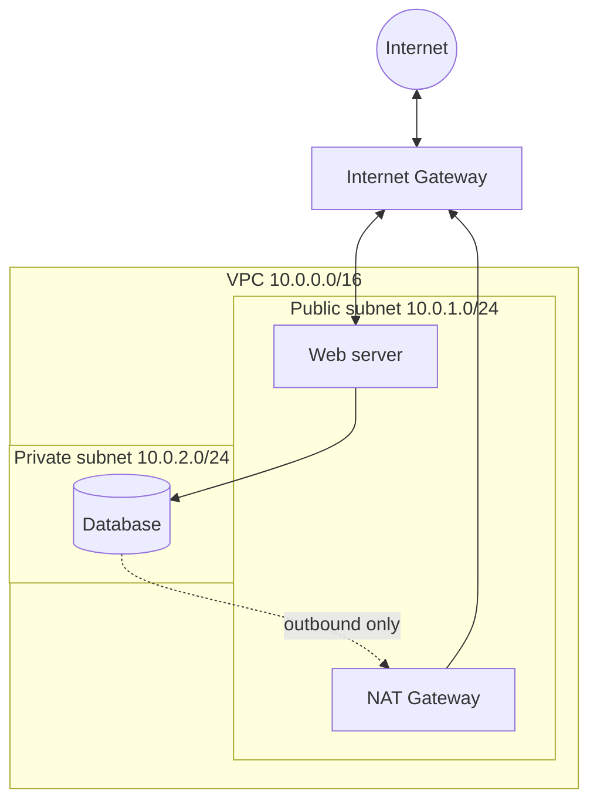

# Lab 05: VPC Fundamentals (Theory)

> **Privacy note:** the addresses used here (`10.0.0.0/16` and its subnets) are generic examples, not my real network.

## Objective
Understand how a Virtual Private Cloud (VPC) is organized before building one in AWS, and connect all the networking concepts from Labs 01 to 04.

## 1. What is a VPC?
A VPC is a private, isolated virtual network inside a cloud provider. I choose its address range (CIDR), split it into subnets and control how traffic enters and leaves. It is the same ideas as my home lab (IP, subnet, gateway, firewall), but defined in software.

## 2. Example design

## 3. Components
| Component | Role |
|-----------|------|
| VPC CIDR (`10.0.0.0/16`) | The whole address space; 65,536 addresses. |
| Subnet | A slice of the VPC (for example `/24`), tied to one availability zone. |
| Public subnet | Its route table sends `0.0.0.0/0` to an Internet Gateway. |
| Private subnet | No direct route to the Internet Gateway; not reachable from the Internet. |
| Route table | Rules that decide where traffic for each destination goes (the gateway concept from Lab 01). |
| Internet Gateway (IGW) | Two-way door between the VPC and the Internet. |
| NAT Gateway | Lets private resources start outbound connections (updates, APIs) without being reachable from outside. Lives in a public subnet and has an hourly cost. |
| Security group | Stateful firewall attached to a resource: default deny inbound, explicit allows (like UFW in Lab 04). |
| Network ACL | Stateless firewall at subnet level; an extra layer. |

## 4. Design rules
- Public subnet: only what must be reachable (load balancer, web tier).
- Private subnet: databases and internal services.
- Security groups follow least privilege: open only the needed ports, and reference other security groups instead of wide IP ranges when possible.
- AWS reserves 5 addresses per subnet, so a `/24` has 251 usable hosts.
- Plan CIDR ranges so they do not overlap with other networks I may connect later.

## 5. From a URL to a loaded page
1. **DNS:** the browser asks the local resolver, which asks a DNS server and gets an IP address (Lab 02).
2. **Routing:** the destination is outside my subnet, so packets go to the default gateway (Lab 01).
3. **TCP connection:** a connection to port 443 is opened on the server.
4. **Firewall:** the server's firewall or security group must allow that port (Lab 04).
5. **TLS handshake:** client and server agree on encryption and the server proves its identity with a certificate (Lab 03).
6. **HTTP:** the browser sends a `GET` request and receives a status code, headers and the page (Lab 03).
7. **Rendering:** the browser loads extra resources the same way and draws the page.

In a cloud setup, between steps 2 and 4 the traffic also passes the Internet Gateway, a route table and a security group before reaching the server in the public subnet.

## Key takeaways
- A VPC combines the concepts already practiced: addressing, subnets, routing, gateways and firewalls.
- Public vs private is decided by the route table, not by the name of the subnet.
- Private resources reach the Internet through a NAT Gateway, and nobody reaches them from outside.
- Security groups are the cloud version of the default-deny firewall.

## Next
Phase 3: advanced Git. VPC will be built hands-on in the AWS phase.