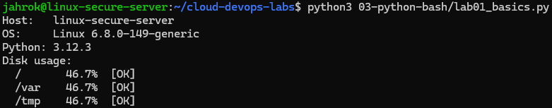

# Lab 01: Python Basics for System Administration

## Objective
Practice Python fundamentals (variables, functions, conditionals, loops, f-strings, standard library) by writing a script that reports basic server information and classifies disk usage.

## Environment
- Ubuntu Server 24.04 LTS virtual machine, Python 3.12.3
- Script: `lab01_basics.py` (standard library only: `platform`, `shutil`, `socket`)

## What the script does
- `get_hostname()` returns the host name.
- `disk_usage_percent(path)` computes used space as a percentage.
- `classify(percent)` returns `OK`, `WARNING` (>= 75) or `CRITICAL` (>= 90).
- `main()` prints host, operating system and Python version, then loops over `/`, `/var` and `/tmp`.
- `if __name__ == "__main__":` runs `main()` only when the file is executed directly, so the functions can be imported and tested.

## Result
```
Host:   linux-secure-server
OS:     Linux 6.8.0-149-generic
Python: 3.12.3
Disk usage:
  /       46.7%  [OK]
  /var    46.7%  [OK]
  /tmp    46.7%  [OK]
```

The three paths report the same value because they live on the same partition.



## Testing the logic
Importing the module and calling `classify` with sample values:

```
python3 -c "import sys; sys.path.insert(0,'03-python-bash'); import lab01_basics as l; print(l.classify(80), l.classify(95), l.classify(10))"
WARNING CRITICAL OK
```

## Issues found
- The script was first committed inside the `screenshots/` folder; it was moved to `03-python-bash/` with a follow-up commit.
- The test command was first run in Windows CMD, where Python is not installed; it must run on the VM.

## Key takeaways
- Small functions with one job are easy to test and reuse.
- Constants (`WARNING_LEVEL`, `CRITICAL_LEVEL`) keep thresholds in one place.
- The standard library covers many admin tasks without installing packages.
- `if __name__ == "__main__":` separates running a script from importing it.
- Confirm which machine a command runs on before executing it.

## Next
Lab 02: reading files and handling errors.