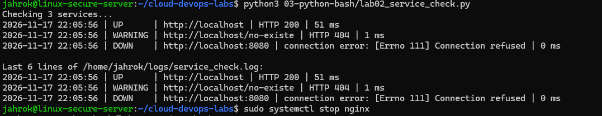
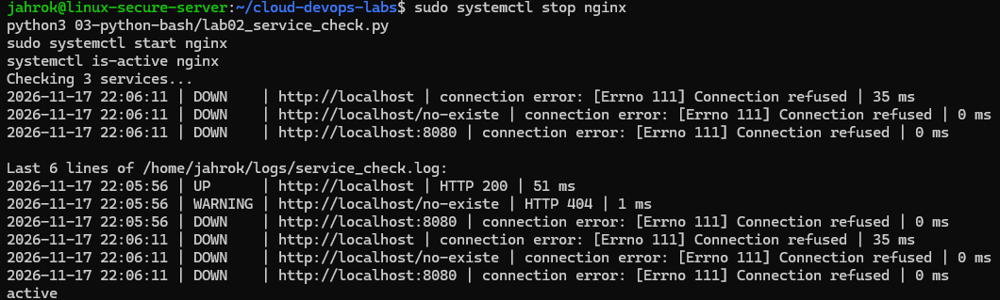
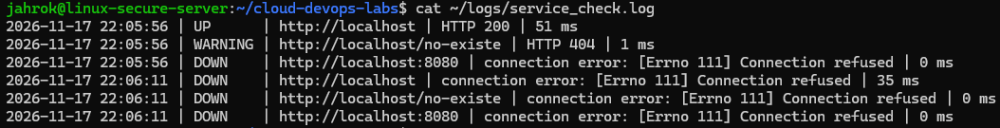

# Lab 02: Files and error handling

## Goal

Write a Python script that checks whether services respond, handles failures without crashing, and appends every result with a timestamp to a log file.

## Environment

- Ubuntu Server 24.04 VM, Python 3.12.3.
- Script: [`lab02_service_check.py`](lab02_service_check.py) (standard library only: `urllib`, `os`, `time`, `datetime`).
- Log file: `~/logs/service_check.log`, kept outside the repository.

## What the script does

It checks three URLs on the VM and classifies each one:

| Result | Meaning |
|--------|---------|
| `UP` | The server answered with a success code. |
| `WARNING` | The server answered with an HTTP error such as 404. |
| `DOWN` | No answer at all: connection refused, unreachable or timeout. |

Each result is printed and appended to the log with date, time, status, URL, detail and elapsed milliseconds. At the end the script reads the log back and prints the last lines.

## Error handling

```python
try:
    with urllib.request.urlopen(url, timeout=timeout) as response:
        status = "UP"
except urllib.error.HTTPError as error:
    status = "WARNING"
except urllib.error.URLError as error:
    status = "DOWN"
```

`HTTPError` is a subclass of `URLError`, so it must be caught first. Otherwise a 404 would be reported as DOWN.

## File handling

- `open(LOG_FILE, "a")` appends, so earlier results are kept.
- `with open(...)` closes the file automatically, even if an error happens.
- `os.makedirs(LOG_DIR, exist_ok=True)` creates the folder only when it is missing.
- Reading and writing are wrapped in `try` and `except` (`OSError`, `FileNotFoundError`) so a log problem never stops the checks.

## Test 1: nginx running

```bash
python3 03-python-bash/lab02_service_check.py
```

- `http://localhost` returned `UP` (HTTP 200).
- `http://localhost/no-existe` returned `WARNING` (HTTP 404): the server works, the page does not exist.
- `http://localhost:8080` returned `DOWN` (Connection refused): nothing listens on that port.



## Test 2: nginx stopped

```bash
sudo systemctl stop nginx
python3 03-python-bash/lab02_service_check.py
sudo systemctl start nginx
systemctl is-active nginx
```

All three URLs returned `DOWN` with `[Errno 111] Connection refused`. The script finished normally instead of crashing, and nginx was restarted afterwards (`active`).



## The log file

```bash
cat ~/logs/service_check.log
```

The log contains the results of both runs, one line per check, so the change from UP to DOWN is visible over time.



## Concepts learned

- A 404 is a valid server answer (WARNING), not a network failure (DOWN).
- `Connection refused` (Errno 111) means the host answered but nothing listens on that port. A timeout would instead mean no answer at all, for example a firewall dropping packets. The timeout path was not triggered in this lab.
- A script that fails must report the failure and keep running.
- Logs live outside the repository so runtime data is never committed.

## Lessons

- Order of `except` blocks matters: from most specific to most general.
- Test the failure path on purpose (stopping a service) and restore it afterwards.
- Verify with `git status` that the log did not enter the repository.

## Evidence

Screenshots in `screenshots/`: `02-check-nginx-up.png`, `03-check-nginx-down.png` and `04-log-file.png`. No IP addresses appear because all checks use `localhost`.