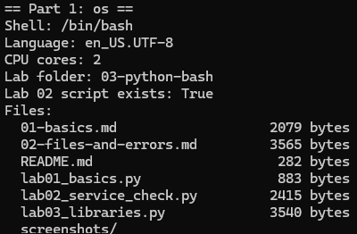
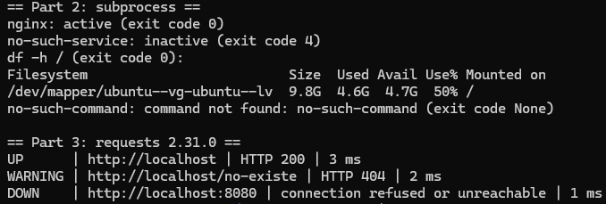
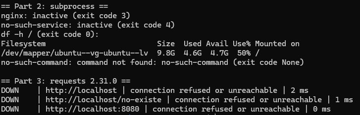

# Lab 03: The os, subprocess and requests libraries

## Goal

Write one Python script that uses three libraries to automate system tasks: `os` to work with the environment and the file system, `subprocess` to run system commands and capture their output, and `requests` to query web services.

## Environment

- Ubuntu Server 24.04 VM, Python 3.12.3.
- Script: [`lab03_libraries.py`](lab03_libraries.py).
- `os` and `subprocess` are part of the standard library. `requests` (version 2.31.0) is a third-party library that was already installed on the VM, so no `pip` or virtual environment was needed.

## Part 1: os

The script reads the environment and lists the lab folder.

| Function | Use |
|----------|-----|
| `os.getenv("SHELL", "unknown")` | Reads an environment variable, with a default if it is missing. |
| `os.cpu_count()` | Number of CPU cores (2 on this VM). |
| `os.path.abspath(__file__)` | Absolute path of the script, so it works from any folder. |
| `os.path.join(...)` | Builds paths without hard-coding separators. |
| `os.path.exists(...)` | Checks whether a file exists. |
| `os.scandir(...)` | Lists a folder; `entry.is_file()` and `entry.stat().st_size` give type and size. |



## Part 2: subprocess

```python
result = subprocess.run(
    command, capture_output=True, text=True, timeout=5
)
```

- `command` is a **list** (`["systemctl", "is-active", "nginx"]`), not a string. Without `shell=True` the arguments are never interpreted by a shell, which avoids command injection when a value comes from outside.
- `capture_output=True` and `text=True` return the output as a string in `result.stdout`.
- `result.returncode` is the exit code: 0 means success, anything else means a problem.
- `timeout=5` stops a command that hangs.
- `FileNotFoundError` is caught when the command does not exist. In that case no process ran, so there is no exit code and the function returns `None`.

Results observed:

| Command | nginx running | nginx stopped |
|---------|---------------|---------------|
| `systemctl is-active nginx` | `active`, exit code 0 | `inactive`, exit code 3 |
| `systemctl is-active no-such-service` | `inactive`, exit code 4 | `inactive`, exit code 4 |
| `df -h /` | 50% used, exit code 0 | 50% used, exit code 0 |
| `no-such-command` | command not found, no exit code | command not found, no exit code |

Key observation: `systemctl is-active` prints `inactive` both for a stopped service (code 3) and for a service that does not exist (code 4). The output text alone cannot tell them apart. The exit code can.



## Part 3: requests

```python
try:
    response = requests.get(url, timeout=3)
    response.raise_for_status()
except requests.exceptions.HTTPError:
    ...
except requests.exceptions.Timeout:
    ...
except requests.exceptions.ConnectionError:
    ...
except requests.exceptions.RequestException:
    ...
```

- `requests.get` does not raise an error for a 404 by itself. `raise_for_status()` turns 4xx and 5xx codes into an `HTTPError`.
- The order of the `except` blocks matters. `Timeout` goes before `ConnectionError` because a connect timeout belongs to both. `RequestException` is the base class and goes last.
- The timeout path was not triggered in this lab.

| URL | nginx running | nginx stopped |
|-----|---------------|---------------|
| `http://localhost` | UP (HTTP 200) | DOWN |
| `http://localhost/no-existe` | WARNING (HTTP 404) | DOWN |
| `http://localhost:8080` | DOWN | DOWN |

With nginx stopped, the script finished normally instead of crashing, and nginx was restarted afterwards (`active`).



## requests compared with urllib (Lab 02)

| | urllib (Lab 02) | requests (Lab 03) |
|---|---|---|
| Availability | Standard library | Third-party package |
| HTTP 404 | Raises `HTTPError` automatically | Needs `raise_for_status()` |
| Error detail | The reason included the `Errno 111` text | The script prints a generic message; the detail is inside the exception |
| Code | More verbose | Shorter and easier to read |

Both gave the same UP, WARNING and DOWN classification for the same URLs.

## Concepts learned

- `os` works with the environment and file paths; `subprocess` runs external commands; `requests` talks to web services.
- Pass commands to `subprocess.run` as a list and avoid `shell=True`.
- Read the exit code, not only the text output.
- Catch exceptions from most specific to most general.
- A third-party library needs to be installed first. When it is missing, a virtual environment is the correct way to install it on Ubuntu 24.04.

## Lessons

- Test the failure path on purpose (stopping a service) and restore it afterwards.
- Use `os.path.join` and `__file__` so a script does not depend on where it is run.
- Verify with `git status` that the repository stayed clean.

## Evidence

Screenshots in `screenshots/`: `05-os-and-files.png`, `06-run-nginx-up.png` and `07-run-nginx-down.png`. No IP addresses appear because all checks use `localhost`.