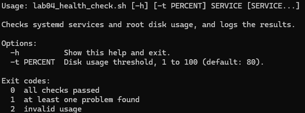
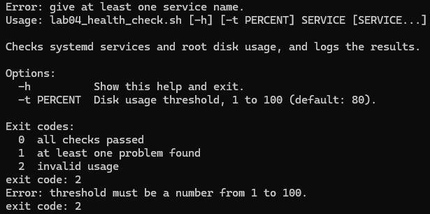
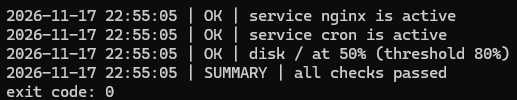
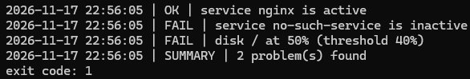
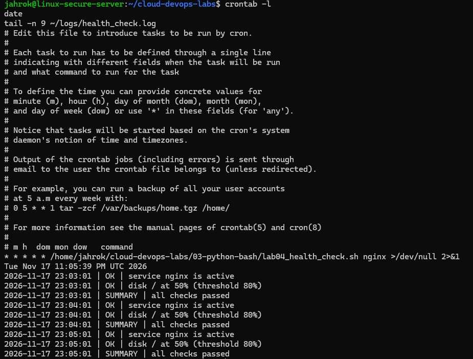

# Lab 04: Advanced Bash (functions, arguments and cron)

## Goal

Write a Bash script that checks systemd services and disk usage, takes its input from command-line arguments, reports problems through exit codes, and runs on a schedule with cron. Then compare cron with the systemd timer already used in Linux Secure Server.

## Environment

- Ubuntu Server 24.04 VM, GNU Bash 5.2.21.
- Script: [`lab04_health_check.sh`](lab04_health_check.sh), stored with LF line endings and the executable bit set in Git.
- Log file: `~/logs/health_check.log`, kept outside the repository.
- A `.gitattributes` file (`*.sh text eol=lf`) was added first so Windows never turns the script into CRLF, which breaks scripts on Linux.

## What the script does

```text
lab04_health_check.sh [-h] [-t PERCENT] SERVICE [SERVICE...]
```

It checks every service given as an argument, checks the usage of `/` against a threshold (default 80%), prints each result and appends it to the log with a timestamp.

| Exit code | Meaning |
|-----------|---------|
| 0 | All checks passed. |
| 1 | At least one problem found. |
| 2 | Invalid usage (missing service, unknown option, bad threshold). |

## Bash concepts used

| Concept | Where |
|---------|-------|
| Functions | `usage`, `log_result`, `check_service`, `check_disk`, `main`. |
| Local variables | `local service="$1"` keeps variables inside the function. |
| Arguments | `$1`, `$#` and `"$@"` (all arguments, each one preserved). |
| Options | `getopts ":ht:"` reads `-h` and `-t VALUE`; `shift $((OPTIND - 1))` removes the options so only the services remain. |
| Conditionals | `[[ ... ]]` for text and patterns, `(( ... ))` for numbers. |
| Loop | `for service in "$@"` checks each service. |
| Return values | `return 0` or `return 1` in functions; `$?` holds the last exit code. |
| Counting failures | `check_service "$service" \|\| problems=$((problems + 1))` increments only when the function fails. |
| Validation | The threshold must match `^[0-9]+$` and be between 1 and 100. `10#$threshold` forces base 10, so a value such as `08` is not read as octal. |

Arguments are validated before the log file is touched, so a wrong call exits with code 2 without writing to the log.

## Test 1: help

```bash
./03-python-bash/lab04_health_check.sh -h
```

Prints the usage, the options and the exit codes, then exits with 0.



## Test 2: invalid usage (exit code 2)

```bash
./03-python-bash/lab04_health_check.sh
echo "exit code: $?"
./03-python-bash/lab04_health_check.sh -t 150 nginx
echo "exit code: $?"
```

- No service given: `Error: give at least one service name.` followed by the usage.
- Threshold 150: `Error: threshold must be a number from 1 to 100.`
- Both returned exit code 2. Errors go to standard error (`>&2`), so they do not mix with normal output.



## Test 3: everything healthy (exit code 0)

```bash
./03-python-bash/lab04_health_check.sh nginx cron
echo "exit code: $?"
```

Both services were `active`, the disk was at 50% against an 80% threshold, and the summary was `all checks passed`.



## Test 4: problems found (exit code 1)

```bash
./03-python-bash/lab04_health_check.sh -t 40 nginx no-such-service
echo "exit code: $?"
```

- `no-such-service` returned `FAIL`.
- The disk at 50% returned `FAIL` because the threshold was lowered to 40% on purpose.
- The summary reported 2 problems and the exit code was 1.
- Options must come before the services, because `getopts` stops at the first argument that is not an option.

As in Lab 03, `systemctl is-active` prints `inactive` for a service that does not exist, so the log text cannot tell a stopped service from a missing one.



## Scheduling with cron

```bash
crontab -e
```

Line added:

```text
* * * * * /home/<USER>/cloud-devops-labs/03-python-bash/lab04_health_check.sh nginx >/dev/null 2>&1
```

| Field | Value | Meaning |
|-------|-------|---------|
| Minute | `*` | Every minute |
| Hour | `*` | Every hour |
| Day of month | `*` | Every day |
| Month | `*` | Every month |
| Day of week | `*` | Every day of the week |

- The script is called with an absolute path because cron runs with a minimal environment and a short `PATH`.
- `>/dev/null 2>&1` discards the output because the script already writes its own log.

After a few minutes the log showed three consecutive runs, one minute apart (23:03, 23:04 and 23:05), each with `OK` for nginx, `OK` for the disk and a `SUMMARY`.



The job was removed afterwards with `crontab -r`, and `crontab -l` returned `no crontab for <USER>`. A test job that keeps running every minute would fill the log for nothing.

## cron compared with systemd timers

The backup in Linux Secure Server uses `backup.timer`. `systemctl list-timers backup.timer` showed the next run at 00:00 UTC and the last run at 00:00:11 UTC the day before.

| | cron | systemd timer |
|---|------|---------------|
| Definition | One line per job in the crontab | Two unit files: `.service` (what) and `.timer` (when) |
| Edit | `crontab -e` | Files